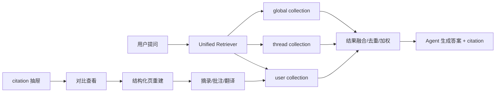
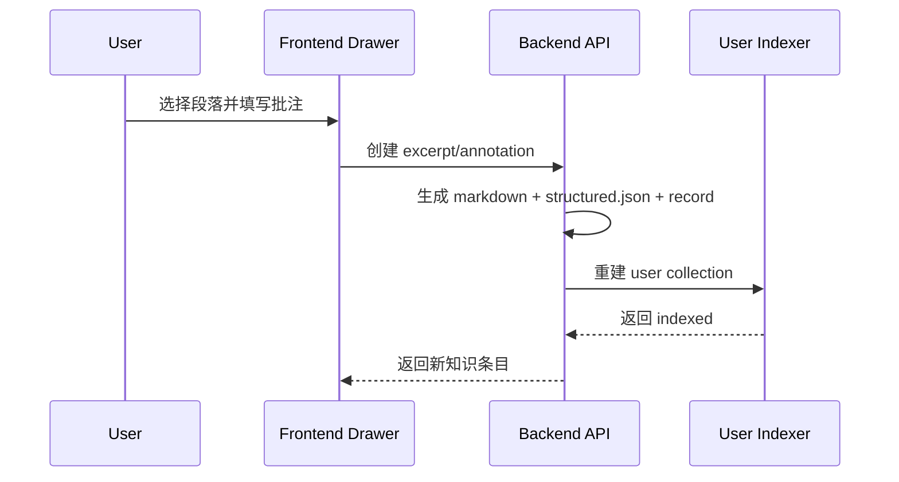

# 个人知识库与批注 RAG 技术方案

## 1. 结论

你的整体方向是合适的，而且和当前仓库已有能力是能接上的：

1. 新增“个人知识库”是合理的，但要明确它是 `user scope`，不是现在已有的 `thread scope` 上传库。
2. “从公共书籍导入为自己的文档并做批注”是合理的，但不建议直接复制整本书到个人库；应优先做“收藏 + 摘录 + 批注”的轻量映射。
3. citation 抽屉增加“对比查看 / 批注 / 翻译”也合理，但当前仓库里的结构化文档是 `.structured.json`，不是 `structure.json`，并且目前更适合先做“段落级选择”，再演进到“任意区域选择”。
4. 批注不建议再独立做一套完全平行的 RAG 产品形态；更合适的是把批注、摘录、翻译都纳入“用户知识域”的统一召回，只是在检索时给不同类型不同权重。

这意味着最稳妥的目标架构不是“两套 RAG”，而是“三层知识域，一个统一检索入口”：

- 公共知识库 `global`
- 当前会话上传库 `thread`
- 用户个人知识库 `user`

---

## 2. 当前仓库现状

### 2.1 已有能力

当前仓库已经具备以下基础：

1. 公共知识库上传、OCR、结构化落盘、索引、检索
   - `backend/src/gateway/routers/knowledge.py`
   - `backend/src/community/knowledge_base/indexer.py`
   - `backend/src/community/knowledge_base/retriever.py`

2. 会话级私有上传库
   - `backend/src/gateway/routers/uploads.py`
   - `backend/src/community/knowledge_base/ingestion.py`
   - 当前是按 `thread_id` 存储，并写入独立 Qdrant collection

3. 结构化文档与 citation 定位
   - `backend/src/community/knowledge_base/structured_document.py`
   - `backend/src/community/knowledge_base/locator.py`
   - `frontend/src/components/workspace/citations/citation-link.tsx`
   - `frontend/src/components/workspace/artifacts/artifact-file-detail.tsx`

4. 用户身份基础
   - 前端已经引入 better-auth
   - `frontend/src/app/api/secure-langgraph/[...path]/route.ts` 已经在 thread metadata 中写入 `user_id`

### 2.2 当前缺口

当前缺的不是 OCR 或 citation，而是下面三件事：

1. 没有 `user scope` 的长期知识存储目录与索引 collection
2. 没有“从公共知识导入到个人知识”的资产模型
3. 没有“批注 / 翻译 / 摘录”作为可检索知识单元的写入链路

---

## 3. 设计目标

### 3.1 功能目标

1. 新增个人知识库入口，展示用户自己的文档、收藏、摘录、批注、翻译。
2. 支持把公共知识库中的文档加入个人库。
3. 支持从 citation 定位页发起摘录、批注、翻译。
4. 新增的用户内容要立即参与后续 RAG 召回。
5. 不破坏现有 `global + thread` 检索逻辑。

### 3.2 非目标

第一期不建议做以下内容：

1. 不做整本书复制式“另存为个人副本”作为默认行为。
2. 不做独立的“批注专用大模型问答入口”。
3. 不做复杂协作权限，先只做单用户私有。
4. 不做页内自由画框 OCR 重跑，先基于已有结构化段落/bbox 选择。

---

## 4. 推荐总体架构



核心原则：

1. 检索入口仍然只有一个，避免 Agent 决策复杂度失控。
2. `user` 域只是一种新的知识来源，不是另一套完全独立系统。
3. 个人库中的内容以“小颗粒、高价值、强锚点”为主，而不是复制大体量原书。

---

## 5. 三层知识域定义

### 5.1 global

公共知识库，已有实现：

- 存储位置：`knowledge/docs` 及其 `.ingestion`
- 索引集合：`knowledge_base`
- 用途：全局书籍、公共材料、基础参考资料

### 5.2 thread

当前会话上传库，已有实现：

- 存储位置：`backend/.deer-flow/threads/{thread_id}/user-data/uploads`
- 索引集合：`knowledge_base__thread__{thread_id}`
- 用途：会话期临时资料、问答过程中的外部补充文档

### 5.3 user

新增个人知识库：

- 存储位置建议：`backend/.deer-flow/users/{user_id}/knowledge/`
- 索引集合建议：`knowledge_base__user__{user_id}`
- 用途：
  - 用户上传的长期个人资料
  - 从公共知识库收藏的书目映射
  - 用户摘录
  - 用户批注
  - 机器翻译结果

---

## 6. 存储设计

### 6.1 新目录结构

建议扩展 `backend/src/config/paths.py`，新增用户级目录：

```text
backend/.deer-flow/
├── threads/{thread_id}/...
└── users/{user_id}/knowledge/
    ├── docs/
    ├── .ingestion/
    ├── .derived/
    └── .catalog/
```

说明：

1. `docs/` 存用户上传的原始文档或用户生成的 markdown 文档。
2. `.ingestion/` 存 `.structured.json` 和 ingestion record。
3. `.derived/` 存摘录、批注、翻译这类派生文档。
4. `.catalog/` 存个人库书目映射和展示元数据。

### 6.2 为什么不默认复制整本公共书籍

如果用户点击“加入个人知识库”就复制整本 PDF/structured 文件，会有三个问题：

1. 存储膨胀
2. 索引重复，召回结果会被同一本书多次污染
3. 元数据维护复杂，公共文档更新后个人副本会漂移

因此建议拆成两类动作：

1. `收藏到个人库`
   - 只建立一个 `user_library_entry`
   - 引用公共文档 `doc_id / filename`
   - 不复制全文，不单独入向量库

2. `摘录到个人库`
   - 把某一页/段/区域生成用户派生文档
   - 可附带批注、标签、翻译
   - 这部分才进入 `user` collection

---

## 7. 数据模型设计

### 7.1 用户知识文档主记录

建议新增 `user knowledge record`，最少包含：

```json
{
  "id": "uk_xxx",
  "user_id": "user_xxx",
  "source_kind": "upload | import_ref | excerpt | annotation | translation | note",
  "title": "晚清盐税改革摘录",
  "display_title": "晚清盐税改革摘录",
  "origin_scope": "global | thread | user",
  "origin_doc_id": "民国财政史.pdf",
  "origin_filename": "民国财政史.pdf",
  "origin_anchor": {
    "page_no": 120,
    "pdf_page_no": 123,
    "paragraph_no": 4,
    "bbox": { "x": 12, "y": 30, "width": 200, "height": 80 }
  },
  "derived_from_id": "uk_parent_xxx",
  "tags": ["盐税", "晚清", "制度史"],
  "retrieval_enabled": true,
  "created_at": "2026-03-22T00:00:00Z",
  "updated_at": "2026-03-22T00:00:00Z"
}
```

### 7.2 批注文档格式

批注建议不要只存一条孤立 comment，而要存成“可检索文档”：

```markdown
# 批注：晚清盐税改革

来源：民国财政史.pdf
定位：原书第120页 第4段

原文摘录：
……

我的批注：
……
```

这样可以直接复用当前的：

1. `build_structured_document`
2. `save_structured_document`
3. `indexer._load_structured_documents`
4. `retriever.search`

### 7.3 翻译块格式

翻译建议也以派生文档形式存储，但元数据要标记：

```json
{
  "source_kind": "translation",
  "language": "zh-CN",
  "origin_language": "文言文",
  "derived_from_id": "uk_excerpt_xxx",
  "retrieval_enabled": true,
  "retrieval_boost": 0.85
}
```

原因：

1. 用户可能直接用现代汉语提问，翻译文本能提升召回率。
2. 但翻译文本不应压过原文和用户批注，因此要降低权重。

---

## 8. 结构化文档与页面复原方案

### 8.1 当前结构化文档能力

当前 `.structured.json` 已经包含：

1. `pages`
2. `paragraphs`
3. `page_no / pdf_page_no / paragraph_no`
4. `bbox`
5. `meta.page_width / meta.page_height`

对于 MinerU 产出，这已经足够支持：

1. 页级复原
2. 段落级定位
3. bbox 高亮
4. 基于段落的摘录和批注

### 8.2 方案建议

第一期不要做真正的“任意像素区域选择”，而是做“段落块选择”：

1. 使用 `.structured.json` 中的 `paragraphs + bbox` 复原页面区块
2. 用户点击/框选多个段落块
3. 以选中的段落块生成摘录与批注

这样能直接复用现有数据，不需要重新定义底层 OCR 协议。

### 8.3 为后续自由区域选择预留 schema v2

如果后续确实要支持更精细的“区域拖选”，建议把结构化文档扩展到 `schema_version = 2`：

```json
{
  "pages": [
    {
      "blocks": [
        {
          "block_id": "b1",
          "type": "paragraph",
          "text": "...",
          "bbox": {}
        }
      ]
    }
  ]
}
```

但这应是第二阶段，不建议在第一期先做。

---

## 9. citation 抽屉改造

### 9.1 当前状态

当前 citation 点击后：

1. `CitationLink` 会把知识文档传给 artifact drawer
2. `ArtifactFileDetail` 对 PDF 类型会进入 `KnowledgeCitationPdfViewer`
3. 后端通过 `/api/knowledge/docs/{filename}/paragraph-location` 返回段落定位和 bbox
4. 前端通过 `/api/knowledge/docs/{filename}/page-image` 渲染页面图片并覆盖高亮框

这条链路已经可以作为“对比查看”的基础。

### 9.2 新增交互

在 citation 抽屉中新增按钮：

1. `对比查看`
2. `加入个人库`
3. `添加批注`
4. `逐块翻译`

建议交互如下：

1. 用户点击 citation
2. 右侧抽屉打开并定位到原文页
3. 点击 `对比查看`
4. 抽屉切到双栏模式
   - 左侧：原始 PDF 页图 + bbox 高亮
   - 右侧：由 `.structured.json` 复原的段落块列表
5. 用户选择若干块后，可执行：
   - 摘录到个人库
   - 添加批注
   - 翻译选中块

### 9.3 为什么要双栏，而不是只看页图

只看页图不利于：

1. 文本选择
2. 翻译插入
3. 批注编辑
4. 结构化存储

双栏能同时满足“保持原书定位感”和“结构化编辑”。

---

## 10. 检索与召回设计

### 10.1 统一检索接口扩展

建议把现有：

```python
retriever.search(query, thread_id=thread_id, doc_ids=doc_ids)
```

扩展为：

```python
retriever.search(
    query,
    thread_id=thread_id,
    user_id=user_id,
    doc_ids=doc_ids,
    scopes=["user", "thread", "global"]
)
```

### 10.2 召回顺序

建议默认召回顺序：

1. 用户个人知识 `user`
2. 当前会话上传 `thread`
3. 公共知识 `global`

但不是先查一个再查下一个，而是三路并行召回后融合排序。

### 10.3 加权策略

建议引入元数据权重：

| source_kind | scope | 默认权重 |
|---|---|---|
| annotation | user | 1.30 |
| excerpt | user | 1.20 |
| upload | user | 1.10 |
| translation | user | 0.85 |
| upload | thread | 1.00 |
| structured/global book | global | 0.95 |

最终分数：

```text
final_score = similarity_score * scope_boost * source_kind_boost
```

### 10.4 为什么不单独做“批注 RAG”

如果给批注单开一套 RAG，会带来：

1. Agent 需要多做一次路由判断
2. citation 来源会变复杂
3. 用户问题往往同时需要原文、个人理解、上下文书籍

更合理的方式是：

1. 批注和摘录仍进同一个 `user` collection
2. 通过 metadata 区分类型
3. 通过权重让批注更容易被命中

---

## 11. API 设计建议

### 11.1 鉴权边界

当前后端 Gateway 并不直接感知登录态，用户身份主要在前端 Next.js 层。  
因此新增 `user knowledge` API 时，建议沿用现有模式：

1. 前端通过 server route 获取 session
2. 由前端安全代理把 `user_id` 注入到后端请求
3. 后端只处理 `user_id` 对应的目录和 collection

### 11.2 建议新增接口

#### 用户知识库

1. `GET /api/users/me/knowledge/list`
2. `POST /api/users/me/knowledge/upload`
3. `POST /api/users/me/knowledge/import-from-global`
4. `POST /api/users/me/knowledge/excerpts`
5. `POST /api/users/me/knowledge/annotations`
6. `POST /api/users/me/knowledge/translations`
7. `DELETE /api/users/me/knowledge/{id}`

#### citation 对比查看

1. `GET /api/users/me/knowledge/compare-page`
   - 输入：`origin_scope`, `filename/doc_id`, `page_no/pdf_page_no`
   - 输出：页图、结构化块、已有用户批注、已有翻译

#### 检索

1. `GET /api/knowledge/search`
   - 增加 `user_id` 和 `scopes`

或者提供：

2. `GET /api/users/me/knowledge/search`
   - 内部仍复用统一检索器

---

## 12. 后端改造清单

### 12.1 路径与存储

需要修改：

1. `backend/src/config/paths.py`
   - 新增 `user_dir`
   - 新增 `user_knowledge_dir`
   - 新增 `user_knowledge_docs_dir`
   - 新增 `user_knowledge_ingestion_dir`

### 12.2 个人知识 ingestion

建议新增：

1. `backend/src/community/knowledge_base/user_ingestion.py`
2. `backend/src/community/knowledge_base/user_store.py`

职责：

1. 保存用户知识记录
2. 保存派生 markdown / structured 文件
3. 建立 `origin_anchor`
4. 维护用户知识 catalog

### 12.3 索引器

修改 `backend/src/community/knowledge_base/indexer.py`：

1. 增加 `rebuild_user_knowledge_index(user_id)`
2. 复用现有 `_load_documents_from_paths`
3. 为用户知识打上 metadata：
   - `scope = user`
   - `user_id`
   - `source_kind`
   - `origin_scope`
   - `origin_doc_id`
   - `origin_anchor`

### 12.4 检索器

修改 `backend/src/community/knowledge_base/retriever.py`：

1. 增加 `user collection` 查询
2. 合并 `user + thread + global`
3. 在 merge 后做加权排序
4. 在 dedupe 时按 `origin_doc_id + page/paragraph + source_kind` 去重

### 12.5 文档定位

修改 `backend/src/community/knowledge_base/locator.py`：

1. 支持 `user scope` 文档定位
2. 支持从用户摘录反查原始公共文档锚点

### 12.6 路由

建议新增：

1. `backend/src/gateway/routers/user_knowledge.py`

不要把所有个人知识接口继续塞进 `knowledge.py`，否则职责会过重。

---

## 13. 前端改造清单

### 13.1 导航

当前 `frontend/src/components/workspace/workspace-header.tsx` 只有：

1. 新对话
2. 知识库管理

建议新增一个明确入口：

1. `个人知识库`

路由建议：

- `/workspace/knowledge` 保留为公共知识库管理
- `/workspace/personal-knowledge` 新增为个人知识库

### 13.2 个人知识库页面

建议新增：

1. `frontend/src/app/workspace/personal-knowledge/page.tsx`
2. `frontend/src/core/knowledge/user-api.ts`
3. `frontend/src/core/knowledge/user-hooks.ts`

页面包含三类列表：

1. 我的收藏
2. 我的摘录/批注
3. 我的上传文档

### 13.3 citation 抽屉

修改：

1. `frontend/src/components/workspace/artifacts/artifact-file-detail.tsx`

新增能力：

1. 对比查看按钮
2. 双栏模式
3. 段落块选择
4. 批注输入
5. 翻译插入
6. 一键写入个人知识库

### 13.4 结构化页组件

建议新增组件：

1. `StructuredPageCompare`
2. `StructuredParagraphBlock`
3. `AnnotationComposer`
4. `TranslationBlock`

---

## 14. 批注与翻译写入流程

### 14.1 批注流程



批注文档建议同步生成两份内容：

1. 面向展示的 markdown
2. 面向检索的 structured document

### 14.2 翻译流程

翻译建议按段落块处理：

1. 用户选择一个或多个段落块
2. 前端请求翻译接口
3. 返回每个块的译文
4. 前端把译文插入块下方
5. 用户点击“保存到个人库”
6. 后端保存为 `translation` 派生文档

注意：

1. 翻译不建议自动无感落库
2. 应由用户确认后落库
3. 否则个人库会被大量低价值翻译噪音污染

---

## 15. 推荐实施阶段

### 第一阶段：用户长期知识库打底

目标：

1. 建立 `user scope` 存储目录
2. 建立 `user collection`
3. 新增个人知识库页面
4. 支持用户上传长期个人文档
5. 统一检索支持 `user_id`

### 第二阶段：公共知识导入与批注

目标：

1. 支持“收藏到个人库”
2. 支持 citation 定位后摘录到个人库
3. 支持批注写入并参与召回

### 第三阶段：对比查看与翻译

目标：

1. citation 抽屉双栏对比查看
2. 段落块选择
3. 逐块翻译
4. 翻译结果落库

### 第四阶段：精细区域与 schema v2

目标：

1. 任意区域选择
2. 更细粒度 block/span 结构
3. 更复杂的页内布局复原

---

## 16. 风险与规避

### 16.1 重复索引污染

风险：

1. 公共书籍被用户重复复制
2. 同一段原文、摘录、翻译、批注同时命中

规避：

1. 默认收藏不复制全文
2. merge 时按 `origin_anchor` 去重
3. 对 translation 降权

### 16.2 结构化精度不够

风险：

当前 `.structured.json` 主要是 paragraph 级，不一定覆盖表格、边注、页眉脚。

规避：

1. 第一阶段只支持段落块
2. 非结构化区域继续保留页图查看
3. 后续再演进 schema v2

### 16.3 鉴权边界模糊

风险：

后端 Gateway 目前没有完整用户鉴权上下文。

规避：

1. 沿用 Next.js secure proxy 注入 `user_id`
2. 个人知识 API 不直接暴露匿名访问

---

## 17. 最终建议

建议按下面的取舍推进：

1. 方向保留：个人知识库、批注、翻译、citation 对比查看都值得做。
2. 架构调整：不要把“批注”再做成一套独立 RAG，而是纳入统一的 `user scope retrieval`。
3. MVP 调整：不要先做任意区域框选，先做段落块选择。
4. 数据策略调整：不要默认复制公共书全文，先做收藏映射 + 摘录落库。

如果按这个方案落地，和当前仓库最契合的演进路径是：

1. 先补 `user scope` 存储与索引
2. 再补 citation 到个人知识的写入链路
3. 最后补对比查看和翻译增强

这样改动面可控，而且每一阶段都能独立上线验证。
