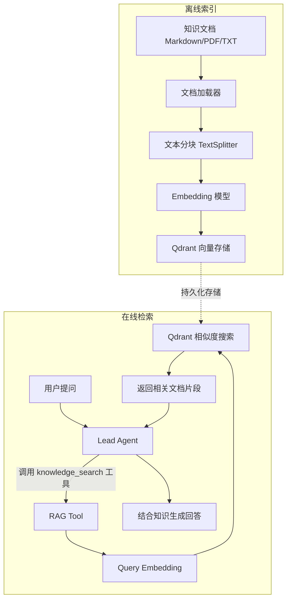
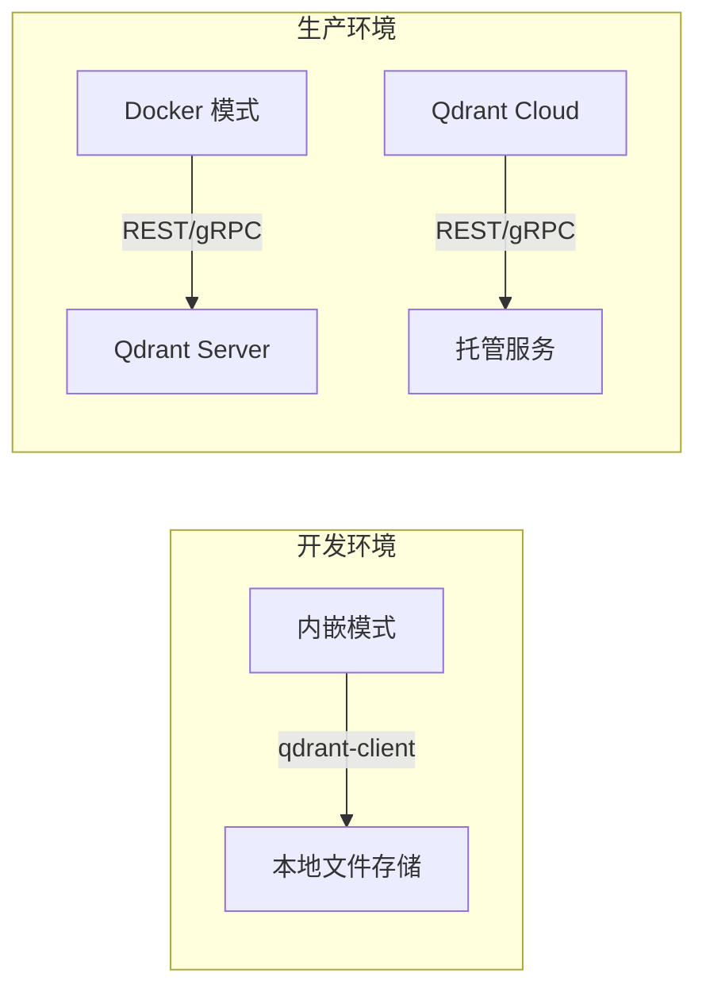
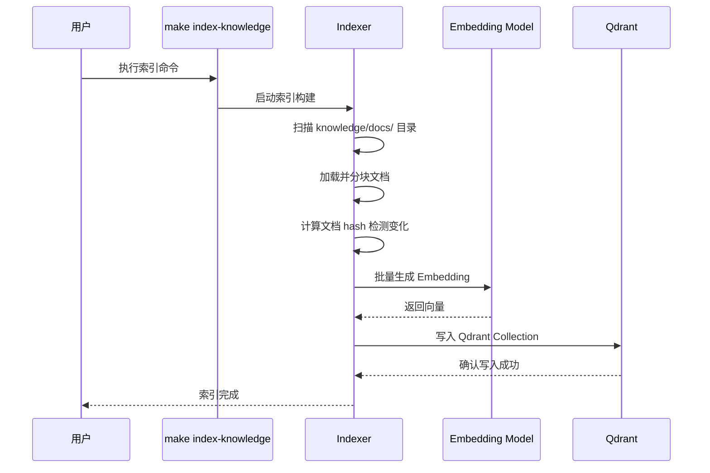
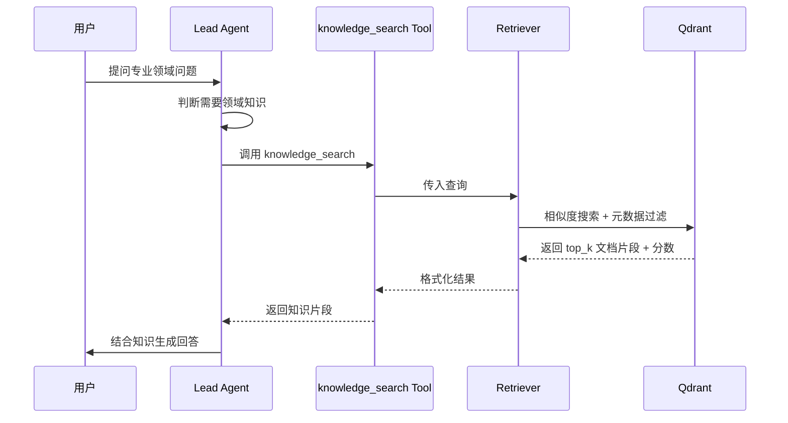
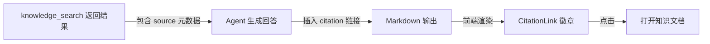

# 财政历史大模型 — RAG 知识库集成方案

## 需求概述

在财政历史大模型系统中加入专业领域知识库，使 Agent 在回答问题时能自动检索和参考这些知识。当前文档量较少，但未来会持续增长。

---

## 方案设计：RAG 工具集成（Qdrant + LangChain）

### 设计原则

遵循财政历史大模型现有的架构模式：
- 以 **community tool** 的形式实现（类似 `tavily`、`jina_ai`）
- 通过 `config.yaml` 配置，使用 `use:` 反射加载
- 使用 **Qdrant** 作为向量数据库（支持内嵌模式和客户端-服务器模式）
- 使用 **LangChain** 生态的 Embedding 和 Retriever

### 为什么选择 Qdrant

| 特性 | Qdrant | FAISS |
|------|--------|-------|
| 部署模式 | 内嵌/Docker/云服务 | 仅内嵌 |
| 元数据过滤 | ✅ 原生支持 | ❌ 需手动实现 |
| 持久化 | ✅ 自动持久化 | 需手动保存/加载 |
| 生产就绪 | ✅ 生产级 | 适合原型 |
| REST/gRPC API | ✅ | ❌ |
| 水平扩展 | ✅ 分布式集群 | ❌ |
| LangChain 集成 | ✅ langchain-qdrant | ✅ langchain-community |

### 整体架构



### 目录结构

```
backend/src/community/knowledge_base/
├── __init__.py
├── tools.py              # knowledge_search 工具定义
├── indexer.py            # 文档索引构建器
├── retriever.py          # 检索器封装
└── config.py             # 知识库配置

knowledge/                 # 项目根目录下的知识文档目录
└── docs/                  # 原始知识文档
    ├── topic-1.md
    ├── topic-2.md
    └── ...
```

> **注意**：Qdrant 自行管理数据持久化，无需手动管理索引文件。
> - 内嵌模式：数据存储在 `backend/.deer-flow/qdrant/` 目录
> - 服务器模式：数据由 Qdrant 服务管理

### Qdrant 部署模式



- **内嵌模式**（推荐开发/小规模）：无需额外服务，数据存本地文件
- **Docker 模式**（推荐生产）：`docker run -p 6333:6333 qdrant/qdrant`
- **Qdrant Cloud**（托管服务）：无需运维

---

## 详细实施计划

### 步骤 1：创建知识库配置

在 `config.yaml` 中添加知识库配置段：

```yaml
# Knowledge Base Configuration
knowledge_base:
  enabled: true
  # 知识文档目录（相对于项目根目录）
  docs_path: knowledge/docs
  # Qdrant 配置
  qdrant:
    # 模式: "local" (内嵌模式) 或 "server" (客户端-服务器模式)
    mode: local
    # 内嵌模式的数据存储路径
    local_path: .deer-flow/qdrant
    # 服务器模式的连接配置（mode=server 时生效）
    url: http://localhost:6333
    api_key: null
    # Collection 名称
    collection_name: knowledge_base
  # Embedding 模型配置
  embedding:
    # 使用 OpenAI Embedding（也可换成其他）
    use: langchain_openai:OpenAIEmbeddings
    model: text-embedding-3-small
    api_key: $OPENAI_API_KEY
  # 文本分块配置
  chunking:
    chunk_size: 1000
    chunk_overlap: 200
  # 检索配置
  retrieval:
    top_k: 5                    # 返回最相关的 K 个片段
    score_threshold: 0.3        # 相似度阈值
```

在 `config.yaml` 的 tools 段注册工具：

```yaml
tools:
  # ... 现有工具 ...
  
  - name: knowledge_search
    group: web
    use: src.community.knowledge_base.tools:knowledge_search_tool
```

### 步骤 2：实现知识库配置模块

创建 `backend/src/config/knowledge_base_config.py`：
- 定义 `KnowledgeBaseConfig` Pydantic 模型
- 包含 `docs_path`、`qdrant`（mode/local_path/url/api_key/collection_name）、`embedding`、`chunking`、`retrieval` 配置
- 提供 `get_knowledge_base_config()` 单例访问
- 提供 `load_knowledge_base_config_from_dict()` 从 YAML 加载

### 步骤 3：实现文档索引器

创建 `backend/src/community/knowledge_base/indexer.py`：
- 使用 LangChain 的 `DirectoryLoader` 加载 Markdown/PDF/TXT 文档
- 使用 `RecursiveCharacterTextSplitter` 分块
- 使用配置的 Embedding 模型生成向量
- 根据 Qdrant 模式创建连接：
  - `local` 模式：`QdrantClient(path=local_path)`
  - `server` 模式：`QdrantClient(url=url, api_key=api_key)`
- 使用 `QdrantVectorStore.from_documents()` 写入向量
- 支持增量更新（通过文档 hash 检测变化，避免重复索引）
- 提供 CLI 命令 `make index-knowledge` 手动触发索引

### 步骤 4：实现检索器

创建 `backend/src/community/knowledge_base/retriever.py`：
- 封装 Qdrant 客户端的连接和查询
- 懒加载连接（首次查询时建立）
- 使用 `QdrantVectorStore` 的 `similarity_search_with_score()` 方法
- 支持 `top_k` 和 `score_threshold` 过滤
- 支持元数据过滤（按文档来源、标签等筛选）
- 返回格式化的文档片段（包含来源信息和相关度分数）

### 步骤 5：实现 RAG 工具

创建 `backend/src/community/knowledge_base/tools.py`：
- 使用 `@tool` 装饰器定义 `knowledge_search` 工具
- 工具描述要清晰，让 Agent 知道何时使用
- 接收查询字符串，返回相关知识片段

```python
@tool("knowledge_search", parse_docstring=True)
def knowledge_search_tool(query: str) -> str:
    """Search the internal knowledge base for domain-specific information.
    
    Use this tool when the user asks questions about specialized domain knowledge.
    This searches through curated internal documents and returns
    relevant knowledge snippets with source references.
    
    Args:
        query: The search query describing what information you need.
    """
    # 调用 retriever 检索相关文档
    # 格式化返回结果（包含来源和相关度）
```

### 步骤 6：集成到配置加载流程

修改 `backend/src/config/app_config.py`：
- 在 `AppConfig.from_file()` 中加载 `knowledge_base` 配置段
- 调用 `load_knowledge_base_config_from_dict()`
- 类似 memory、summarization 等配置的加载方式

### 步骤 7：添加索引构建命令

在 `backend/Makefile` 中添加：

```makefile
index-knowledge:  ## Build/rebuild knowledge base index
	python -m src.community.knowledge_base.indexer
```

在根目录 `Makefile` 中添加：

```makefile
index-knowledge:  ## Build/rebuild knowledge base index
	cd backend && python -m src.community.knowledge_base.indexer
```

### 步骤 8：添加 Gateway API 端点（可选）

在 `backend/src/gateway/routers/` 中添加知识库管理路由：
- `GET /api/knowledge` — 查看知识库状态（文档数、索引状态）
- `POST /api/knowledge/reindex` — 触发重新索引
- `POST /api/knowledge/upload` — 上传新文档

---

## 依赖项

需要安装的 Python 包：

```
qdrant-client      # Qdrant 客户端（支持内嵌模式和服务器模式）
langchain-qdrant   # LangChain Qdrant 集成
langchain-openai   # OpenAI Embedding（已有依赖）
unstructured       # 文档解析（可选，用于 PDF 等格式）
```

---

## 工作流程

### 索引阶段（离线/手动）



### 查询阶段（在线/自动）



---

## 与现有系统的集成点

| 集成点 | 文件 | 修改内容 |
|--------|------|----------|
| 工具注册 | `config.yaml` | 添加 `knowledge_search` 工具和 `knowledge_base` 配置段 |
| 配置加载 | `backend/src/config/app_config.py` | 加载 `knowledge_base` 配置段 |
| 新增配置 | `backend/src/config/knowledge_base_config.py` | 新建知识库配置模块 |
| 工具发现 | `backend/src/tools/tools.py` | 无需修改，通过 `resolve_variable` 自动加载 |
| 新增模块 | `backend/src/community/knowledge_base/` | 新建 RAG 模块（4 个文件） |
| 知识文档 | `knowledge/docs/` | 新建知识文档目录 |
| 构建命令 | `Makefile` + `backend/Makefile` | 添加 `index-knowledge` 命令 |
| 依赖管理 | `backend/pyproject.toml` | 添加 qdrant-client、langchain-qdrant 依赖 |

---

## 前端引用展示与文档查看

### 现有 Citation 机制复用

财政历史大模型已有完整的引用系统，知识库引用可以**零前端改动**地复用：

1. **Agent 输出**：使用 `[citation:文档标题](/api/knowledge/docs/filename.md)` 格式
2. **前端渲染**：`MarkdownContent` 组件自动检测 `citation:` 前缀，渲染为 `CitationLink` 徽章
3. **用户交互**：hover 显示文档信息预览，点击打开知识文档

### 知识库引用流程



### 步骤 9：knowledge_search 工具返回格式

工具返回的每个知识片段需包含来源信息，Agent 会据此生成引用：

```
## 检索结果

### 来源 1: topic-1.md - 相关度: 0.92
[内容片段...]
文档链接: /api/knowledge/docs/topic-1.md

### 来源 2: topic-2.md - 相关度: 0.85
[内容片段...]
文档链接: /api/knowledge/docs/topic-2.md
```

Agent 在回答中会自动使用 citation 格式引用：
```markdown
根据内部知识库，XXX 的最佳实践是... [citation:专业领域指南](/api/knowledge/docs/topic-1.md)
```

在工具返回结果末尾添加 Prompt 提示，引导 Agent 正确使用引用格式：

```
---
IMPORTANT: When using information from these knowledge base results in your response,
you MUST cite the source using this format: [citation:Document Title](/api/knowledge/docs/filename.md)
Also include a "参考文献" / "References" section at the end listing all cited documents.
```

### 步骤 10：添加知识文档服务 API

在 Gateway 中添加知识文档服务路由 `backend/src/gateway/routers/knowledge.py`：

| 端点 | 方法 | 说明 |
|------|------|------|
| `/api/knowledge/docs/{filename}` | GET | 返回知识文档原文，支持 Markdown 渲染 |
| `/api/knowledge/status` | GET | 返回知识库状态：文档数、索引状态、最后更新时间 |
| `/api/knowledge/reindex` | POST | 触发重新索引 |
| `/api/knowledge/search` | GET | HTTP 接口的知识搜索，供前端直接调用 |

关键端点 `GET /api/knowledge/docs/{filename}`：
- 返回知识文档的原始 Markdown 内容
- 前端 `CitationLink` 点击后打开此 URL
- 支持 `?format=html` 参数返回渲染后的 HTML
- 支持 `?download=true` 参数下载原始文件

### 步骤 11：前端知识文档查看器（可选增强）

如果需要更好的文档查看体验，可以在前端添加：

1. **知识文档查看页面**：类似 artifact 的 Markdown 预览，复用 `ArtifactFileDetail` 组件
2. **知识库浏览面板**：在侧边栏展示所有知识文档列表
3. **搜索框**：直接在前端搜索知识库

但这些是**可选增强**，基础方案只需复用现有 citation 机制 + 文档服务 API 即可。

### 引用效果示意

Agent 回答中的引用会渲染为：

```
根据内部知识库，XXX 的最佳实践是使用 YYY 方法...
[📄 专业领域指南 ↗]  [📄 最佳实践手册 ↗]

## 参考文献
1. 专业领域指南 - /api/knowledge/docs/topic-1.md
2. 最佳实践手册 - /api/knowledge/docs/topic-2.md
```

其中 `[📄 专业领域指南 ↗]` 是可点击的 CitationLink 徽章，hover 显示文档信息，点击打开文档内容。

---

## Docker 部署（可选）

如果使用服务器模式，可在 `docker/docker-compose-dev.yaml` 中添加 Qdrant 服务：

```yaml
services:
  qdrant:
    image: qdrant/qdrant:latest
    ports:
      - "6333:6333"
      - "6334:6334"
    volumes:
      - qdrant_data:/qdrant/storage
    restart: unless-stopped

volumes:
  qdrant_data:
```

---

## 与现有系统的集成点（更新）

| 集成点 | 文件 | 修改内容 |
|--------|------|----------|
| 工具注册 | `config.yaml` | 添加 `knowledge_search` 工具和 `knowledge_base` 配置段 |
| 配置加载 | `backend/src/config/app_config.py` | 加载 `knowledge_base` 配置段 |
| 新增配置 | `backend/src/config/knowledge_base_config.py` | 新建知识库配置模块 |
| 工具发现 | `backend/src/tools/tools.py` | 无需修改，通过 `resolve_variable` 自动加载 |
| 新增 RAG 模块 | `backend/src/community/knowledge_base/` | indexer.py, retriever.py, tools.py, __init__.py |
| 新增 Gateway 路由 | `backend/src/gateway/routers/knowledge.py` | 知识文档服务和管理 API |
| Gateway 注册 | `backend/src/gateway/routers/__init__.py` | 注册 knowledge 路由 |
| Nginx 代理 | `docker/nginx/nginx.conf` | 添加 `/api/knowledge` 代理规则 |
| 知识文档 | `knowledge/docs/` | 新建知识文档目录 |
| 构建命令 | `Makefile` + `backend/Makefile` | 添加 `index-knowledge` 命令 |
| 依赖管理 | `backend/pyproject.toml` | 添加 qdrant-client、langchain-qdrant 依赖 |

---

## 未来扩展

1. **自动索引**：监听文档目录变化，自动触发重新索引
2. **混合检索**：结合 BM25 关键词搜索和向量语义搜索（Qdrant 原生支持稀疏向量）
3. **多租户**：利用 Qdrant 的 payload 过滤，按 thread 或用户隔离知识
4. **前端知识库管理界面**：上传、删除、搜索、浏览知识文档
5. **Qdrant Cloud**：迁移到 Qdrant 托管服务，无需运维
6. **Embedding 缓存**：利用 Qdrant 的 upsert 机制，通过文档 hash 避免重复 Embedding
7. **多 Collection**：按领域/项目创建不同的 Collection，支持多知识库
8. **知识文档版本管理**：跟踪文档变更历史
